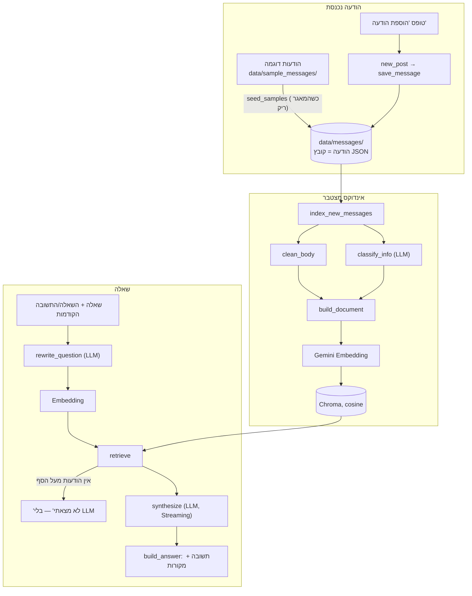

# ארכיטקטורה

מסמך זה: **איך המערכת בנויה** — הזרימה, הקבצים והפונקציות.
**למה** כל בחירה — [summary_for_me.md, סעיף 3](summary_for_me.md#3-החלטות-טכנולוגיות-ולמה). בעיות — [problems_log.md](problems_log.md).

## תרשים זרימה



## מסלול של הודעה
| שלב | מה קורה | קובץ → פונקציה |
|---|---|---|
| 1 | התלמידה ממלאת שם, נושא, תוכן ו"בתגובה להודעה" | `app.py` → `add_message_tab` |
| 2 | מזהה ותאריך (שעון ישראל) נקבעים אוטומטית | `src/messages.py` → `new_post` |
| 3 | נשמרת כקובץ JSON ב-`data/messages/` | `src/messages.py` → `save_message` |
| 4 | אינדוקס מצטבר — רק הודעות שעוד לא באינדקס, במנות של 10 | `src/indexer.py` → `index_new_messages` |
| 5 | ניקוי: HTML → טקסט, ציטוט של הודעה קודמת, חתימה | `src/clean.py` → `clean_body` |
| 6 | סימון "יש מידע / אין מידע" — קריאת LLM אחת למנה | `src/indexer.py` → `classify_info` |
| 7 | Document: נושא + גוף נקי + metadata; בתגובה — ציטוט קצר מהאב | `src/indexer.py` → `build_document` |
| 8 | Embedding ושמירה ב-Chroma | `index.insert_nodes` (LlamaIndex) |

## מסלול של שאלה
| שלב | מה קורה | קובץ → פונקציה |
|---|---|---|
| 1 | השאלה, והשאלה והתשובה הקודמות | `app.py` → `questions_tab` |
| 2 | ניסוח מחדש: שאלה עצמאית ומלאה | `src/query.py` → `rewrite_question` |
| 3 | Embedding של הניסוח | `src/query.py` → `prepare` |
| 4 | 10 הודעות → ציון × 0.95 להודעות בלי מידע → סף 0.72 → + הודעות אב → מיון מהישנה לחדשה ומספור | `src/query.py` → `retrieve`, `parent_nodes` |
| 5 | אין הודעות מעל הסף → "לא מצאתי מידע" בלי קריאה ל-LLM | `ask` / `ask_stream` |
| 6 | פרומפט: 12 כללים + ההודעות בתגיות `<message number="N">` + השאלה המקורית + הניסוח | `synthesize` (`QA_PROMPT`) |
| 7 | Gemini כותב תשובה (Streaming) ומסיים ב"מקורות: 2, 5"; השורה מוסתרת בזמן ה-Streaming | `SourcesHidingStream` |
| 8 | מפרידים תשובה ממקורות; מקורות לא תקינים → כל ההודעות שנשלחו | `build_answer` |
| 9 | מוצגים: תשובה, "חיפשתי:", מקורות, טוקנים | `app.py` → `render_answer` |

## הקבצים
| קובץ | תפקיד |
|---|---|
| `app.py` | ממשק Streamlit: "שאלות" ו"הוספת הודעה"; עולה פעם אחת (`st.cache_resource`), מזהה בנייה מחדש של האינדקס, שגיאות ידידותיות |
| `src/__init__.py` | `truststore` — HTTPS דרך מאגר התעודות של Windows (נטפרי) |
| `src/config.py` | הגדרות (top_k, סף, מכפיל, נתיבים) ומודלי Gemini |
| `src/messages.py` | פורמט ההודעה, שמירה, העתקת הדוגמאות |
| `src/clean.py` | ניקוי גוף ההודעה |
| `src/indexer.py` | Documents, סימון has_info, אינדוקס מצטבר, `index_info.json` |
| `src/query.py` | ניסוח מחדש, אחזור, פרומפט, תשובה ומקורות, Streaming |
| `tests/evaluate.py` | סט הבדיקות: נכונות (שופט), Recall@k, MRR, טוקנים, זמנים |
| `tests/inspect_retrieval.py` | מה נשלף ובאיזה ציון, בלי LLM |
| `tests/make_sample_messages.py` | יוצר את הודעות הדוגמה |

## פורמט הודעה (`data/messages/*.json`)
```json
{"message_id": "<sample-12@sample.test>", "date": "2026-10-29T08:05:00+02:00",
 "subject": "המבחן באנגלית נדחה!", "from": "יעל אברהם <yael.avraham@example.com>",
 "in_reply_to": null, "body": "המורה הודיעה עכשיו שהמבחן באנגלית נדחה..."}
```

## מה נכנס ל-Embedding ומה ל-LLM
| שדה | Embedding | LLM | למה |
|---|---|---|---|
| נושא + גוף נקי | ✓ | ✓ | התוכן |
| `from` | ✗ | ✓ | ה-LLM צריך לדעת מי אמרה (סתירות); בחיפוש השם היה מקרב לפי שולחת |
| `date` (קריא, עם יום בשבוע) | ✗ | ✓ | עדכון אחרון ו"מחר"; בחיפוש היה מקרב לפי תאריך |
| `reply_context` (ציטוט קצר מהאב) | ✓ | ✗ | תגובה נמצאת בחיפוש; ה-LLM לא מייחס את הציטוט למשיבה |
| `reply_to` ("בתגובה להודעה של X מ-...") | ✗ | ✓ | ה-LLM יודע למה התגובה מתייחסת |
| `message_id`, `date_ts`, `in_reply_to`, `has_info` | ✗ | ✗ | לקוד ולסינון בלבד |

## רכיבים
LlamaIndex (`SentenceSplitter`, `VectorStoreIndex`, `ChromaVectorStore`, `SimilarityPostprocessor`, `MetadataFilters`,
`get_response_synthesizer`, `TokenCountingHandler`) · Gemini (`gemini-3.5-flash-lite`, `gemini-embedding-2`) ·
Chroma מקומי · Streamlit. הנימוקים — [summary_for_me.md, סעיף 3](summary_for_me.md#3-החלטות-טכנולוגיות-ולמה).
