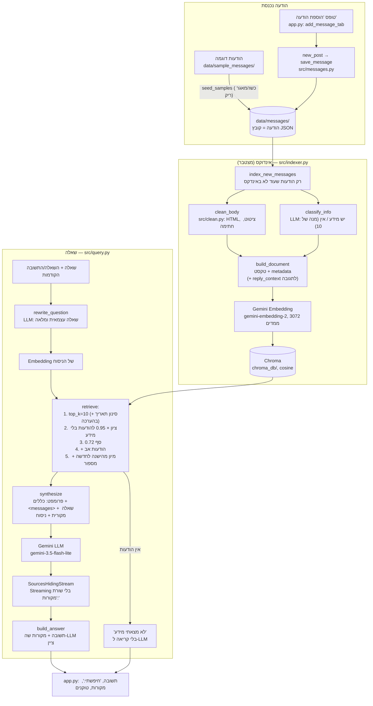

# ארכיטקטורה

## תרשים זרימה



## הקבצים

| קובץ | תפקיד |
|---|---|
| `app.py` | ממשק Streamlit: לשונית "שאלות" (צ'אט + Streaming) ולשונית "הוספת הודעה". עולה פעם אחת (`st.cache_resource`), בודקת שהאינדקס לא נבנה מחדש מתהליך אחר, ומציגה שגיאה ידידותית |
| `src/__init__.py` | `truststore` — אימות HTTPS דרך Windows (נטפרי). רץ לפני כל מודול |
| `src/config.py` | הגדרות (top_k, סף, מכפיל, נתיבים) והגדרת המודלים של Gemini |
| `src/messages.py` | פורמט ההודעה: הודעה חדשה מהטופס, שמירה כ-JSON, העתקת הדוגמאות |
| `src/clean.py` | ניקוי גוף ההודעה: HTML → טקסט, ציטוט של הודעה קודמת, חתימה |
| `src/indexer.py` | בניית Document לכל הודעה, סימון "יש מידע", אינדוקס מצטבר ל-Chroma, בדיקת `index_info.json` |
| `src/query.py` | ניסוח מחדש, אחזור, פרומפט, תשובה עם מקורות, Streaming |
| `tests/evaluate.py` | סט הבדיקות: נכונות (שופט LLM), Recall@k, MRR, טוקנים, זמנים |
| `tests/inspect_retrieval.py` | כלי דיבאג: מה נשלף ובאיזה ציון, בלי LLM |
| `tests/make_sample_messages.py` | יוצר את 26 הודעות הדוגמה |

## פורמט הודעה (`data/messages/*.json`)
```json
{"message_id": "<sample-12@sample.test>", "date": "2026-10-29T08:05:00+02:00",
 "subject": "המבחן באנגלית נדחה!", "from": "יעל אברהם <yael.avraham@example.com>",
 "in_reply_to": null, "body": "המורה הודיעה עכשיו שהמבחן באנגלית נדחה..."}
```

## מה נכנס ל-Embedding ומה ל-LLM (לכל הודעה)

| שדה | Embedding (חיפוש) | LLM (תשובה) | למה |
|---|---|---|---|
| נושא + גוף נקי | ✓ | ✓ | התוכן עצמו |
| `from` (שם השולחת) | ✗ | ✓ | ה-LLM צריך לדעת מי אמרה (סתירות); בחיפוש השם היה מקרב הודעות לפי שולחת |
| `date` (קריא, עם יום בשבוע) | ✗ | ✓ | העדפת הודעה עדכנית ו"מחר"; בחיפוש היה מקרב לפי תאריך |
| `reply_context` (ציטוט קצר מההודעה המקורית) | ✓ | ✗ | תגובה כמו "כן, ביום שני" נמצאת בחיפוש; ה-LLM לא מייחס את הציטוט למשיבה |
| `reply_to` ("בתגובה להודעה של X מ-...") | ✗ | ✓ | ה-LLM יודע למה התגובה מתייחסת |
| `message_id`, `date_ts`, `in_reply_to`, `has_info` | ✗ | ✗ | מזהים ומספרים — לסינון ולקוד, לא לתוכן |

## בחירות טכנולוגיות

| מה | בחירה | למה |
|---|---|---|
| ספריית RAG | LlamaIndex | דרישת התרגיל. רכיבים מוכנים: `SentenceSplitter`, `VectorStoreIndex`, `ChromaVectorStore`, `SimilarityPostprocessor`, `MetadataFilters`, `get_response_synthesizer`, `TokenCountingHandler` |
| מודלים | Gemini (`gemini-3.5-flash-lite`, `gemini-embedding-2`) | מפתח חינמי, עברית טובה. `gemini-3.8-flash` היה עמוס (503) — #2 |
| Vector store | Chroma מקומי, cosine | בלי שרת, נשמר לדיסק; cosine — המדד המקובל לטקסט |
| ממשק | Streamlit | צ'אט, Streaming וטופס בכמה שורות |
| הודעה = Chunk | `chunk_size=1024` | ההודעות קצרות (10-100 טוקנים) ועוסקות בנושא אחד — חיתוך היה מפריד "נדחה" מ"ליום שני" |

פירוט הבעיות והפתרונות: [problems_log.md](problems_log.md) · החלטות שהתקבלו בלילה: [decisions.md](decisions.md).
